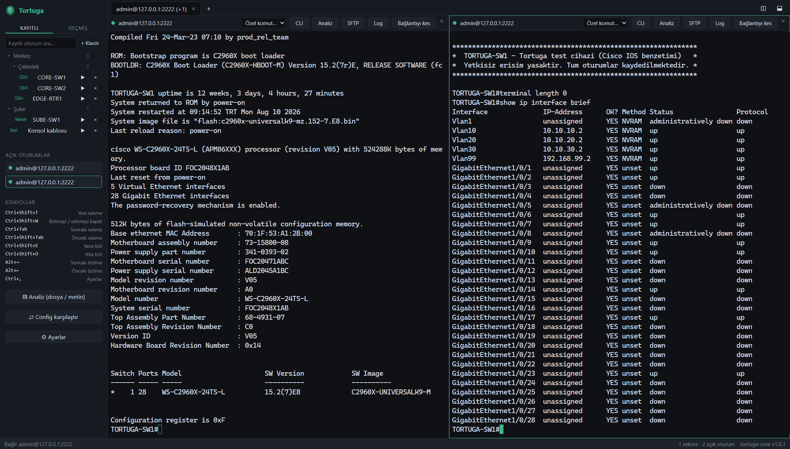
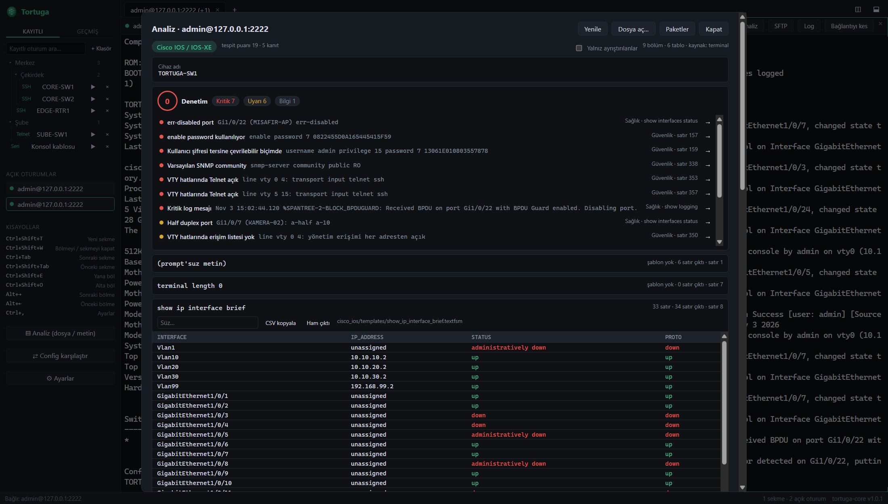
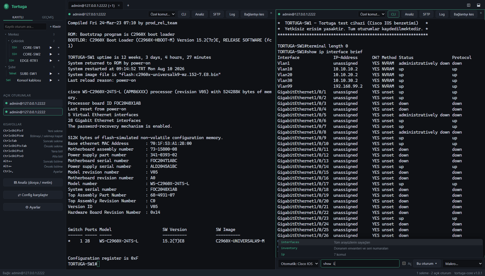
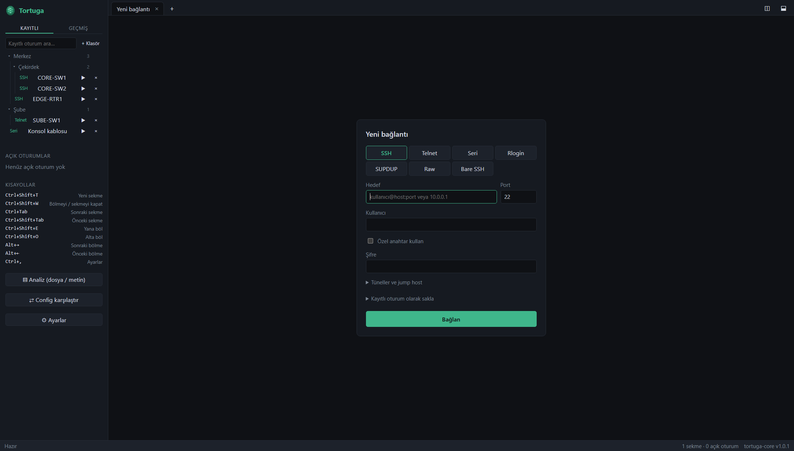

# Tortuga

**Ağ cihazlarına bağlanmak, çıktıları okumak ve config denetlemek için tek terminal.**
SSH, Telnet ve seri konsol aynı pencerede; komut çıktıları tablolara dönüşür, riskli ayarlar kendiliğinden işaretlenir.

[**⬇ Son sürümü indir**](../../releases/latest)  ·  [Kurulum](#kurulum)  ·  [Güvenlik](#güncellemeler-nasıl-güvenli)



## Neler yapar?

### Çıktıyı analiz eder, config'i denetler

Oturumdaki çıktıyı, yapıştırılan metni ya da bir dosyayı tek tıkla inceler. Cihaz türünü tanır, `show` çıktılarını süzülebilir tablolara çevirir; açık Telnet, varsayılan SNMP community, tersine çevrilebilir parola, hatalı port gibi sorunları satırıyla gösterir. İki config'i karşılaştırabilirsin.

Tablo ve denetim desteği: Cisco IOS / IOS-XE, Aruba AOS-CX, Aruba AOS 8, Juniper Junos. Ruijie RGOS için denetim kuralları ve komut sözlüğü var.



### Komutları senin yerine tamamlar

Komut çubuğu bağlandığın cihaza göre dil değiştirir: tamamlama, açıklamalı öneriler ve kısaltma açma sunar. Aynı komutu birden çok oturuma gönderebilir, sık kullandığın adımları makro olarak saklayabilirsin.



### Bütün bağlantıların tek yerde

SSH (parola, özel anahtar, eski cihazlar için eski algoritmalar), Telnet, seri, Rlogin, SUPDUP, Raw ve Bare SSH. Oturumlarını klasörlere ayır; şifreler işletim sisteminin anahtar zincirinde durur. PuTTY oturumlarını içe aktarabilirsin.



### Ve günlük işler için

- Sekmeler ve yatay/dikey bölünmüş ekran
- SFTP dosya paneli
- Port yönlendirme (`-L`, `-R`, `-D`) ve jump host
- Oturum logu ve geçmiş
- Temalar, kısayollar, düşük bellek modu

<sub>Görüntülerdeki oturumlar örnek veridir, bağlanılan cihaz bir test benzeticisidir.</sub>

## Kurulum

1. [Son sürüm](../../releases/latest) sayfasından `Tortuga_<sürüm>_x64-setup.exe` dosyasını indir. Toplu dağıtım için `.msi` da var.
2. Dosyayı çalıştır.
3. "Windows kişisel bilgisayarınızı korudu" uyarısı çıkarsa **Ek bilgi → Yine de çalıştır** de. Kurulum dosyası henüz kod imzalama sertifikasıyla imzalı olmadığı için bu uyarı görünür.

Sonraki sürümler uygulama içinde bildirim olarak gelir ve onayınla kurulur.

| Sistem | Durum |
|---|---|
| Windows 10/11 (64 bit) | Hazır |
| Linux, macOS | Henüz yayınlanmadı |

## Dosyayı doğrulama

Her sürümde `SHA256SUMS.txt` vardır. İndirdiğin dosyanın özeti oradakiyle aynı olmalı:

```
certutil -hashfile Tortuga_<sürüm>_x64-setup.exe SHA256
```

## Güncellemeler nasıl güvenli?

- Her güncelleme paketi, geliştiricinin bilgisayarında çevrimdışı saklanan bir anahtarla imzalanır (`.sig` dosyaları). Anahtar GitHub'da ya da herhangi bir sunucuda bulunmaz.
- Tortuga indirdiği paketi kurmadan önce imzayı, uygulamanın içine gömülü açık anahtarla doğrular. İmza tutmazsa, paket başka bir sürüme aitse ya da daha eski bir sürümse kurulmaz.
- Güncelleme her zaman kullanıcının onayıyla kurulur.

---

Bu repo yalnız derlenmiş sürümleri içerir, kaynak kod burada değildir. Kurulu Tortuga güncellemeleri buradan denetler ve indirir.
